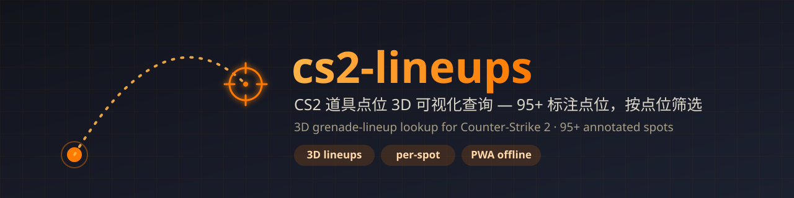

<p align="center"></p>

# CS2 战术沙盘

[](LICENSE)
[](https://github.com/chrislitality-svg/cs2-lineups)
[](https://github.com/chrislitality-svg/cs2-lineups/commits)

单文件 3D 网页应用，用于规划和复习 CS2 各地图的道具点位（烟/闪/火/雷）。基于 [three.js](https://threejs.org/)，全部逻辑、样式、交互都在一个 `index.html` 里。仓库同时收纳「CS2 管家」门户页与饰品租赁页，以及沙盘的云同步后端。

线上：<https://www.huyicun.cloud/cs2/zs/>

## 主要功能

### 战术沙盘（`index.html`）
- **3D 沙盘**：每张地图渲染成俯视 3D 场景，可 WASD/拖拽巡视；three.js 经 CDN 按需加载，速查路径不被大库阻塞。
- **道具点位**：投掷点 → 爆开点的抛物线轨迹；支持**弹点/折点**（弹墙、折叠）和**弧线高低**手动调整。
- **同点位多道具**：一个站位下挂多颗道具，平级切换。
- **图片记录**：站位 / 瞄点 / 效果三张图，存浏览器 IndexedDB。
- **地名区域**：多边形区域 + 文字标签，文字/边界透明度可分别调、可批量改；顶点可拖，按住 Ctrl 点边线加节点。
- **出生点**：标注出生点，可直接当投掷点用。
- **自定义标签**：给道具打标签（自助闪 / 配合闪 …），可建可改可删。
- **PWA**：`manifest.json` + `sw.js` 离线壳，可安装到桌面；云同步请求永不走缓存。
- **云同步**：数据自动同步到自建后端 `cs2sync`（见 `server/`），多设备增量一致；未配置路由时自动降级为纯本地，不影响使用。
- **备份**：一键导出 / 导入完整数据（含图片 base64）。

### CS2 管家门户页（`portal/`）
导航入口 + CS2 资讯聚合，串起「我的租赁」与「战术沙盘」两个工具。

### 我的租赁（`zl/`）
IGXE / BUFF 饰品租赁管理：到期提醒、批量操作、租赁截图 AI 自动识别（识别接口由租赁后端提供，该后端不在本仓库内）。

## 技术栈

原生 HTML/CSS/JS 单文件应用（ESM）· three.js 0.184（CDN 按需加载）· IndexedDB · PWA Service Worker · Python 标准库云同步服务（`http.server`，无第三方依赖）

## 目录结构

```
index.html        # 战术沙盘：整个应用（HTML + CSS + JS 单文件）
manifest.json     # PWA 清单
sw.js             # Service Worker（离线壳 + 资源缓存）
imgs/             # 道具图标 + 背景图
maps/             # 各地图俯视贴图（{地图名}.webp）
portal/           # CS2 管家门户页
zl/               # 我的租赁页
server/           # cs2sync 云同步服务（生产副本，含部署说明 README）
_design/          # 设计 token 校验脚本与演示页
docs/             # banner 等素材
```

## 快速开始 / 部署

纯静态前端，无需构建。本地起任意静态服务器即可：

```bash
python -m http.server 3456
# 浏览器打开 http://localhost:3456/
```

云同步需要单独部署 `server/cs2sync.py`：以 systemd 服务运行，监听本机 8094 端口，由 nginx 反代到 `/cs2/sync/`。数据布局、端点与备份回滚见 [server/README.md](server/README.md)。

正式部署：把 `index.html`、`imgs/`、`maps/`、`portal/`、`zl/`、`manifest.json`、`sw.js` 上传到对应静态目录即可（纯静态，覆盖生效）。`.gitattributes` 已锁死 LF 行尾，保证与生产做字节比对时不出现假告警。

## 许可

[MIT](LICENSE)
